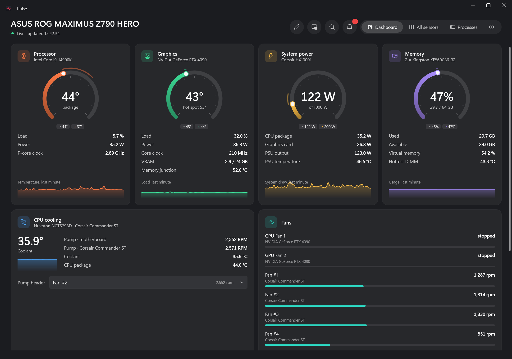
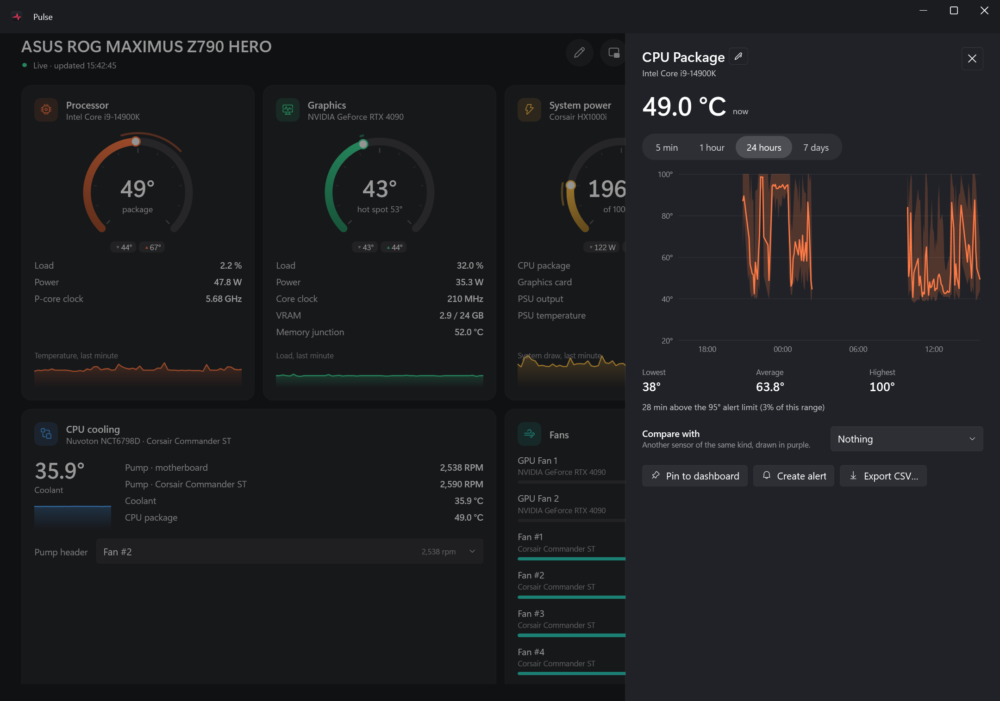
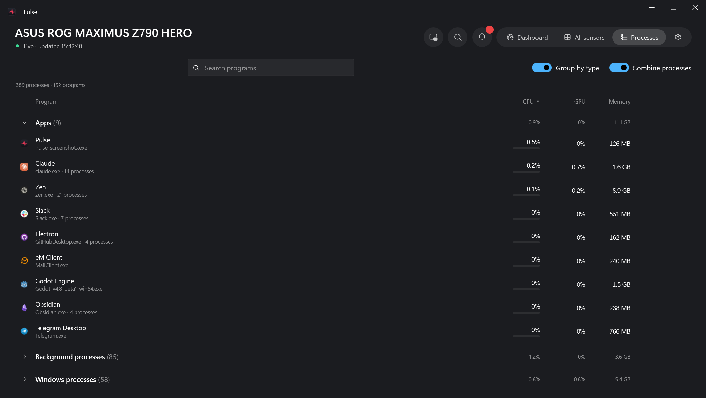
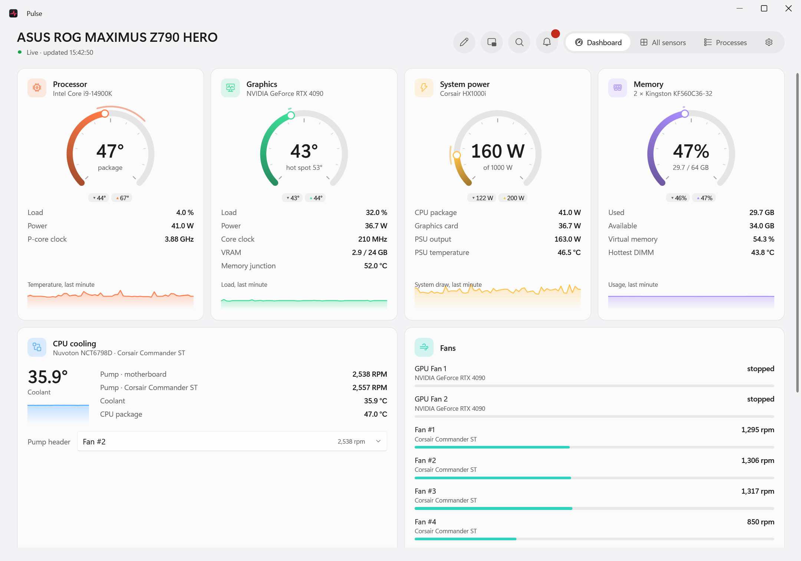
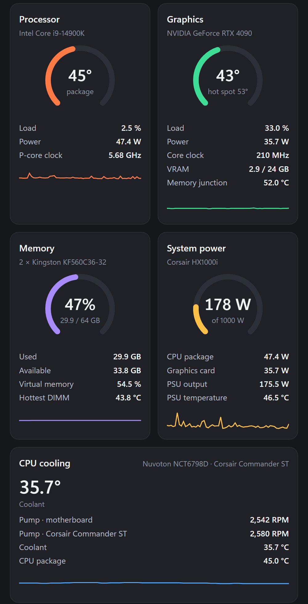
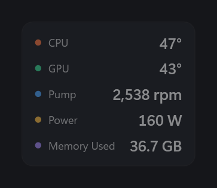

<div align="center">


# Pulse

**A good-looking hardware monitor for Windows.**
Temperatures, fans, pump, power, drives and network, live and at a glance, with history, alerts,
and your PC on your phone.

[](https://github.com/pulsar-a/pulse-app/actions/workflows/ci.yml)




</div>

## Why Pulse

Most hardware monitors are a wall of numbers. Pulse shows what matters at a glance, and has the detail
one click away when you want it.

| | |
|---|---|
| 🌡️ **Everything in one place** | CPU, every core, GPU (hot spot and memory junction too), memory, power from the PSU, drives with their drive letters, fans, network |
| 💧 **Knows your cooling** | Pump speed and coolant temperature, from a motherboard header or straight from a **Corsair Commander** over USB, alongside iCUE without fighting it |
| 🔔 **Tells you when something's wrong** | Alerts for a hot CPU, GPU or drive and a **stopped pump**, as Windows notifications; cards glow orange, then red, as they near their limit |
| 📈 **Remembers** | A week of history for every sensor; click any reading for a chart, its low, high and average, and how long it spent over the limit |
| 🔥 **What's heating your PC** | The programs using the CPU and GPU right now, grouped like Task Manager, with End task for your own apps |
| 📱 **Your PC on your phone** | A live, read-only dashboard in your phone's browser: scan a QR code, nothing to install |
| 🎮 **Stays out of the way** | A tiny always-on-top mini window for games, a live temperature in the tray, and next to no CPU of its own while it's hidden |
| 🎨 **Looks like Windows 11** | Mica, dark and light themes that follow Windows, and Windows' "Animation effects" setting respected everywhere |

## A look around

<p align="center">
  
  
</p>

**Click any reading** for its history, from 5 minutes to 7 days, with the low, the high and the time spent over
its alert limit (left). **Processes** come in Task Manager's three sections, sortable and searchable, one row per
program or per process (right).

<p align="center">
  
  
  
</p>

**Light or dark**, following Windows as it switches (left). **On your phone**: turn it on in Settings and scan
the QR code (middle). The **mini window** stays on top of games, click-through if you like, on a hotkey (right).

<sub>All screenshots are from a real PC (Core i9-14900K, RTX 4090, a Corsair Commander ST cooling controller), recorded live.</sub>

## Get started

> **Note:** a signed installer with automatic updates is on its way ([step 14](docs/plans/14-release.md)).
> Until then, Pulse runs from source; it takes a couple of minutes.

**You need:** Windows 10 or 11 (x64) and the [.NET 10 SDK](https://dotnet.microsoft.com/download).

```powershell
git clone https://github.com/pulsar-a/pulse-app.git
cd pulse-app
make start
```

Windows asks for administrator rights; say yes (see below for why). No `make`? Use `mingw32-make start`, or run
`dotnet run --project src/Pulse` from a terminal opened as administrator.

### Two things for the full picture

1. **Run as administrator.** Windows only lets admin programs read the CPU, motherboard and drive sensors. Turn on
   **Settings → Startup and tray → Start with Windows** and Pulse starts at sign-in with those rights, without a prompt.
2. **Install [PawnIO](https://pawnio.eu)**, the small open driver that the sensor library uses for CPU temperatures,
   clocks and power, and motherboard fans and voltages. Without it you still get the GPU, memory, network, PSU and
   drives; Pulse shows a banner until it's there.

### Good to know

- **Closing the window keeps Pulse in the tray**, so alerts keep working (you can change that in Settings).
  On Windows 11, new tray icons start in the ^ overflow: Pulse moves itself next to the clock, or drag it there.
- **Is your pump on a motherboard header?** If the board doesn't say which header it's on, pick it once on the
  CPU cooling card, and the pump alert watches it from then on.
- **Ctrl+K** finds any sensor by name, device or kind. Right-click a sensor in **All sensors** to rename it,
  pin it to the dashboard, put it in the tray, or alert on it.
- The **pencil** button rearranges the dashboard: drag cards, resize them, hide them, pin any sensor.

## Your PC, your data

- **Pulse only reads.** It never changes fan speeds, voltages, clocks or lighting, including on USB coolers.
- **Nothing goes to the internet.** Settings and history stay in `%LOCALAPPDATA%\Pulse`.
- **The phone view is off until you turn it on.** It answers only on your local network, only to devices with
  your link (which you can replace at any time), it's read-only, and it never opens the firewall by itself.
- **Shares a Corsair cooler politely.** While iCUE (or SignalRGB, OpenRGB, FanControl, HWiNFO…) is running, Pulse
  leaves the controller alone and says so, rather than fight over it.
- **Something wrong?** **Settings → About → Copy diagnostics** makes a report for a bug report. You see all of it
  before it's copied; your web link, user name, computer name and readings are left out.

## Supported hardware

Pulse reads sensors through [LibreHardwareMonitor](https://github.com/LibreHardwareMonitor/LibreHardwareMonitor):
Intel and AMD CPUs, NVIDIA, AMD and Intel GPUs, most motherboards' sensor chips, NVMe and SATA drives, RAM,
network adapters, Corsair HXi and RMi power supplies, and coolers like NZXT Kraken and Aqua Computer.

On top of that, Pulse reads these itself:

| Device | What you get |
|---|---|
| Corsair Commander Core, Core XT and ST (the controllers that come with many Corsair iCUE AIO coolers) | Pump, six fans, coolant temperature, temperature probes |

Want your controller supported? Run `make probe` with it plugged in and
[open an issue](https://github.com/pulsar-a/pulse-app/issues) with the output.

---

## For developers

Pulse is WPF on .NET 10 with [WPF-UI](https://github.com/lepoco/wpfui) and
[CommunityToolkit.Mvvm](https://github.com/CommunityToolkit/dotnet). CI builds and tests every push and pull request.

### Run and test

- **Rider:** open `Pulse.slnx`, pick the **Pulse** configuration, Run. Under the debugger Pulse doesn't ask for
  admin rights (that would start a second, undebugged copy), so start Rider **as administrator** to see every sensor.
- **Command line:**

| Target | What it does |
|--------|--------------|
| `make start` | Build and launch (with the admin prompt) |
| `make build` | Build without launching |
| `make test` | Run the tests; works while Pulse is open |
| `make snapshot` | Record every sensor once, as admin, to `tests/Pulse.Tests/Fixtures/admin.json` (close Pulse first) |
| `make publish` | Release build with ReadyToRun in `artifacts/publish` |
| `make package` | The installer and update packages, as a release builds them, in `artifacts/releases` |
| `make changelog` | What the next release would be: its version and changelog (changes nothing) |
| `make release` | Release: version from the commits, `CHANGELOG.md`, release commit and tag, pushed (asks first). `PRE=beta` for a beta, `VERSION=1.0.0` to choose |
| `make probe` | List supported USB coolers and any cooler software running (sends nothing) |
| `make probe-read` | Read a USB cooler once and log every exchange (close Pulse and iCUE first) |
| `make icon` | Redraw the app icon from `tools/IconGen` |
| `make clean` | Remove build output |

Only one Pulse runs at a time; launching it again brings the open window to the front. Pulse asks for admin
rights itself (the manifest is `asInvoker`), so `--no-elevate` runs it without them, and under a debugger it
doesn't ask.

### Commits and releases

Commit messages follow [Conventional Commits](https://www.conventionalcommits.org): `feat: …` for something new,
`fix: …` for a fix, `perf: …`, and `docs:`, `chore:`, `ci:`, `test:` or `refactor:` for the rest (those don't make
a release on their own). `BREAKING CHANGE:` in the body marks a breaking change.

`make release` turns them into a release with [Versionize](https://github.com/versionize/versionize) (pinned with
vpk in `dotnet-tools.json`; `dotnet tool restore` sets both up). It picks the next version, writes `CHANGELOG.md`,
commits it with the tag, and pushes. The tag starts `.github/workflows/release.yml`, which tests, packages with
Velopack and publishes the GitHub Release, with that version's changelog as its notes. A stable release lists
everything since the last stable one, betas included.

### How it fits together

All LibreHardwareMonitor calls happen in `HardwareService`, on one background thread. Each tick it copies every
sensor into an immutable `HardwareSnapshot` and publishes it on the `SensorStream`, which keeps the last hour in
memory. Everything else (the dashboard, alerts, history, the tray, the mini window, the web view) subscribes to
the stream and never touches the hardware.

```
src/Pulse/
  Services/HardwareService.cs   Polls LHM on a background thread and publishes immutable snapshots
  Services/SensorStream.cs      The hub: an hour of every sensor in memory, and the snapshot event
  Services/History/             A week of per-minute history in SQLite, CSV export
  Services/Processes/           Per-process CPU, GPU and memory sampling, grouped by program
  Services/Coolers/             USB cooler drivers (Corsair Commander), shared politely with iCUE and similar apps
  Services/Web/                 Phone and web view: a read-only local-network server (off by default)
  Web/                          The web view's page, embedded in Pulse
  Models/HardwareSnapshot.cs    Snapshot records handed to the UI thread
  ViewModels/                   Dashboard, All sensors, Processes, details and settings state
  Views/                        XAML for the pages, the details panel, the mini window and the tray
  Controls/                     RingGauge, Sparkline, the history chart and the color palette
  Themes/                       Dark and light tokens, and the shared styles
tests/Pulse.Tests/              xUnit tests, including recorded snapshots and a captured Corsair exchange
tools/                          CorsairProbe (USB cooler checks), IconGen (the app icon)
```

### Roadmap

The plan lives in [docs/plans](docs/plans/README.md), in steps built one at a time. Next up:
[release and distribution](docs/plans/14-release.md) (signed installer, updates, first-run setup).
