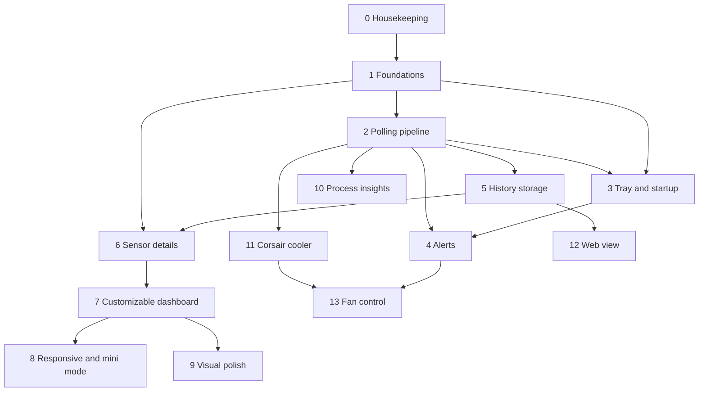

# Pulse development plan

This folder breaks the Pulse roadmap into steps that can be built and shipped one at a time.
Each step has its own file with goals, design, tasks and acceptance criteria.

The order is chosen so that **each step builds on the previous ones instead of reworking them**.
Steps that many later features depend on (settings, sensor naming, theme tokens, the polling
pipeline) come first, even though they're less visible than tray icons or charts.

## Order

| # | Step | Builds on | Main outcome |
|---|------|-----------|--------------|
| 0 ⏳ | [Housekeeping](00-housekeeping.md) | – | Committed baseline, tests, missing-SATA-drive bug solved |
| 1 ✅ | [Foundations](01-foundations.md) | 0 | Settings page, °C/°F, sensor renaming, theme tokens, app icon |
| 2 ✅ | [Polling pipeline and performance](02-polling-and-performance.md) | 1 | Smart polling, in-memory history, faster startup, idle when hidden |
| 3 ✅ | [Tray icon and start with Windows](03-tray-and-startup.md) | 1, 2 | Live tray temperature, minimize to tray, no-UAC autostart |
| 4 ✅ | [Alerts](04-alerts.md) | 1, 2, 3 | Notifications for high temperatures and pump failure |
| 5 ✅ | [History storage](05-history-storage.md) | 2 | Readings saved to SQLite, CSV export |
| 6 ✅ | [Sensor details](06-sensor-details.md) | 1, 2, 5 | Click any sensor for a large chart and stats |
| 7 ✅ | [Customizable dashboard](07-customizable-dashboard.md) | 1, 6 | Pin sensors, reorder and hide cards |
| 8 ✅ | [Responsive layout and mini mode](08-responsive-and-mini-mode.md) | 7 | Reflowing dashboard, always-on-top mini window |
| 9 ✅ | [Visual polish](09-visual-polish.md) | 1, 7 | Heat-reactive cards, light theme, new splash |
| 10 | [Process insights](10-process-insights.md) | 2 | "What's heating my PC" process list |
| 11 | [Corsair cooler over USB](11-corsair-cooler.md) | 1, 2 | Coolant temperature and pump speed from the Corsair controller |
| 12 | [Phone and web view](12-web-dashboard.md) | 2, 5 | Dashboard in a browser on the local network |
| 13 | [Fan control](13-fan-control.md) | 4, 11 | Deferred: safe, limited fan curves (maybe never) |

## Dependency map

## Why this order

- **Settings, naming and theme tokens first (step 1).** Almost every later step adds a settings
  section, shows sensor names, or adds new UI. Doing these once, early, means later steps just
  plug in. Putting theme tokens in place before the UI grows means the light theme in step 9
  costs a palette, not a rewrite of every view.
- **Polling pipeline before anything that consumes data (step 2).** Tray, alerts, history,
  details, process view and the web view all read sensor data. Step 2 turns today's
  "snapshot every second" into a small data pipeline with an in-memory history buffer that all
  of them subscribe to, so none of them talks to LibreHardwareMonitor directly.
- **Tray before alerts (3 → 4).** Notifications need the app to keep running in the background,
  which is what the tray step provides.
- **Storage before the details panel (5 → 6).** The details panel is mostly a view over stored
  history; building it first would mean faking data and redoing it later.
- **Details before the customizable dashboard (6 → 7).** Pinned tiles open the details panel when
  clicked, and the dashboard's layout model reuses the same sensor references.
- **Layout model before responsive and mini mode (7 → 8).** Reflowing and the mini window are
  both views over the dashboard's tile list, so they come after it exists.
- **Risky hardware work last (11, 13).** Talking to the Corsair controller and controlling fans can
  conflict with vendor software or, in the case of fans, affect cooling. They come after alerts,
  so problems are noticed.

## Conventions for every step

- Start from a clean, committed tree; finish with a commit (or PR) per step.
- Keep all LibreHardwareMonitor calls inside the hardware layer (`Services/HardwareService.cs`
  and whatever step 2 grows it into). Views and view models only see snapshots.
- New user-visible options go on the Settings page (created in step 1), persisted through
  `SettingsService`.
- New colors go into theme resources (created in step 1), never as hex values in XAML.
- Anything that could block the UI thread for more than ~16 ms runs in the background.
  The UI watchdog (`Services/UiWatchdog.cs`) logs stalls to `%LOCALAPPDATA%\Pulse\pulse.log`;
  check it before calling a step done.
- Test without admin rights for layout and UX; test as admin, with PawnIO installed, for real sensor data.
